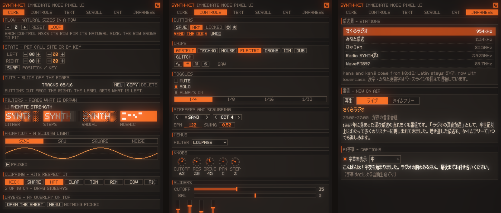
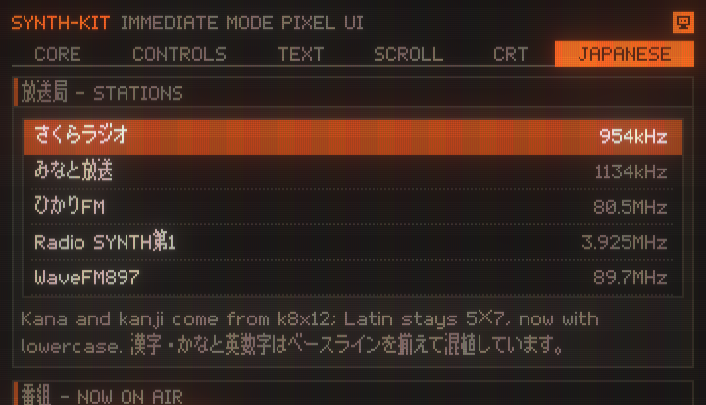

# SynthezKit for Android

An immediate-mode, pixel-art UI framework for Android Views and Jetpack Compose.

This is an unofficial Kotlin port of [SynthezKit](https://github.com/Lakr233/SynthezKit) by Lakr233, which is itself modeled on [synth-ui](https://github.com/unixzii/synth-ui) by Cyandev. The API, the frame model and the look follow the Swift original; the platform layer is rewritten for Android (OpenGL ES 3.0, Choreographer, TalkBack, IME), and a few features were added along the way, most visibly Japanese text.

You describe the whole screen in plain Kotlin every frame. SynthezKit lays it out on a grid of virtual pixels, rasterizes it into a 256-color indexed framebuffer on the CPU, and puts it on screen through OpenGL ES, optionally through a modeled CRT. When nothing moves, the frame loop pauses and the view costs nothing.

```kotlin
val canvas = SZCanvasView(context, SZTheme.synthPalette(), background = 1, resolution = SZResolution.PointScale(1.0))
var count = 0
canvas.body = {
    inset(8)
    row(height = 11, gap = 3, align = SZAlignment.CENTER) {
        if (button("-").clicked) count--
        label(count.toString())
        if (button("+").clicked) count++
    }
}
```

Or in Compose. Compose state read in the body is observed, so a change draws a new frame:

```kotlin
@Composable
fun Counter() {
    var count by remember { mutableIntStateOf(0) }
    SZCanvas(palette = SZTheme.synthPalette(), background = 1, resolution = SZResolution.PointScale(1.5)) {
        if (button("+").clicked) count++
        label(count.toString())
    }
}
```

## Features

From the Swift original:

- **Immediate mode.** Widgets are functions that return what happened this frame (`clicked`, a new value, a picked item). No retained view tree, no callbacks.
- **Stable identity without strings.** State, animations and hit targets are keyed by 64-bit hashes derived from call position, or from an explicit key where order can change.
- **Pixel-exact layout.** A cursor-and-cut layout on whole virtual pixels: rows, columns, natural sizes, RectCut-style slicing, clipping and overlay layers.
- **Palette rendering.** Everything is a palette index. Fades, shadows and dimming map colors to their nearest palette neighbors in OKLab instead of blending, and dissolve with ordered Bayer dithering.
- **Only draws what changed.** An identical frame skips rasterizing and uploading; an idle canvas pauses its Choreographer loop and uses no CPU.
- **Touch-first input.** Taps, drags with capture, flings, rubber-banding and snapping, mouse wheel and hover, and input trickling so a gesture that lands within one frame is never lost.
- **CRT post-process.** Phosphor afterglow, halation, brightness-dependent scanline beams, aperture, slot and shadow masks, and vignette, in linear light.

Added in this port:

- **Japanese text.** A BDF font loader with lazy glyph loading, the bundled [k8x12](https://littlelimit.net/k8x12.htm) font (all JIS level 1 and 2 kanji), a composite font that puts 5×7 Latin (now with lowercase) and 8×12 kana/kanji on one baseline, and kinsoku line breaking. Widget heights follow the font, so the same layout works with either.
- **Images.** `SZImage.quantize` maps photos and logos into the palette (OKLab nearest color with ordered dithering on lightness), and `image()` draws them.
- **Small widget additions.** `list(reveal = row)` scrolls a row into view; `knob(tapToStep = true)` turns one detent per tap, like a rotary selector.
- **TalkBack and IME.** Every interactive widget is an accessibility node that can be activated and adjusted; text fields drive the soft keyboard, including composing text.



## Widgets

| Group | Widgets |
| --- | --- |
| Text | `label`, `paragraph`, `textField` |
| Buttons | `button`, `iconButton`, `textButton`, `checkbox` |
| Choices | `segmented`, `chipGroup`, `tabs`, `dropdown`, `menu` |
| Values | `slider`, `knob`, `stepper`, `scrubValue` |
| Containers | `card`, `scrollView`, `list` (virtual, 10,000 rows cost one screenful), `sheet` |
| Feedback | `statusLine`, `tooltip` |
| Drawing | `fill` with dither patterns, `stroke`, `line`, `circle`, `bitmap`, `image`, `text`, `remap`, `mosaic`, `filter` |

## Requirements

- Android 7.0 (API 24) or later, with OpenGL ES 3.0
- Kotlin 2.0, Android Gradle Plugin 8.x, Java 17

## Installation

Add JitPack to your repositories:

```kotlin
// settings.gradle.kts
dependencyResolutionManagement {
    repositories {
        google()
        mavenCentral()
        maven("https://jitpack.io")
    }
}
```

Then depend on the modules you need:

```kotlin
dependencies {
    implementation("com.github.narakai.SynthezKit-Android:synthez:0.1.1")
    // Compose wrapper (pulls in synthez)
    implementation("com.github.narakai.SynthezKit-Android:synthez-compose:0.1.1")
}
```

| Module | Contents |
| --- | --- |
| `synthez` | Core (layout, identity, input routing, draw list, CPU rasterizer, palette, images, fonts), widgets, and `SZCanvasView`: OpenGL ES presentation, frame loop, touch, keyboard, IME, TalkBack and CRT. |
| `synthez-compose` | `SZCanvas`, a composable that hosts the view, observes Compose state and follows the lifecycle. |

To use Japanese text, load the bundled font once and build a theme from it:

```kotlin
val theme = SZTheme.synth(SZBitmapFont.pixel5x7(SZFontAssets.k8x12(context)))
canvas.ui.setEnvironment(SZThemeKey, theme)
```

## How a frame works

1. A touch or a running animation wakes the Choreographer loop.
2. `SZUI.frame` routes input against the previous frame's hit rectangles, then runs your body. Widgets register hit rectangles, read and write their state, and append draw commands to a list bucketed by layer.
3. If the draw list equals the previous one, nothing else happens. Otherwise `SZSurface` replays it into a one-byte-per-pixel framebuffer.
4. `SZGLPresenter` uploads the framebuffer into an `R8UI` texture and resolves palette colors on the GPU, with sharp-bilinear scaling or the CRT pipeline.
5. When no animation, input or afterglow is pending, the loop pauses.

Resolution is set in virtual pixels per dp with `PointScale`, so pixels look the same size on every density; `PixelScale` (per device pixel) and `Fixed` (letterboxed) are also available.

## Sample app

`sample` runs the gallery: six pages (Core, Controls, Text, Scroll, CRT, Japanese) that exercise every widget. Launch extras help with screenshots:

```sh
adb shell am start -n com.leon.synthez.sample/.MainActivity --es page CRT --ez crt true --ef pxscale 3
```

## Development

```sh
./gradlew :synthez:testDebugUnitTest :sample:testDebugUnitTest   # layout, routing, raster, widgets, fonts, gallery pages
./gradlew :sample:installDebug
```

## Acknowledgements

- [SynthezKit](https://github.com/Lakr233/SynthezKit) by Lakr233 (MIT): this project is a port of it, and its design, API and widgets come from there.
- [synth-ui](https://github.com/unixzii/synth-ui) by Cyandev (MIT), the model for SynthezKit: the immediate-mode API, position-derived keys, previous-frame hit routing, cursor-and-cut layout, the palette, color-map and dither approach, and the CRT pipeline design.
- [k8x12](https://littlelimit.net/k8x12.htm) by Num Kadoma, the bundled Japanese font. Free to use, modify and redistribute; its terms ship as `synthez/src/main/assets/synthez/k8x12-LICENSE.txt`.
- [Dear ImGui](https://github.com/ocornut/imgui) for input queue trickling, and Martin Cohen's RectCut for the slicing layout.
- [OKLab](https://bottosson.github.io/posts/oklab/) by Björn Ottosson for perceptual nearest-color matching.

This port is not affiliated with SynthezKit, synth-ui or their authors.

## License

MIT. See [LICENSE](./LICENSE).
